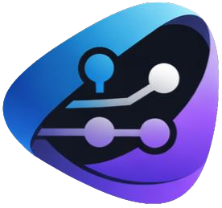
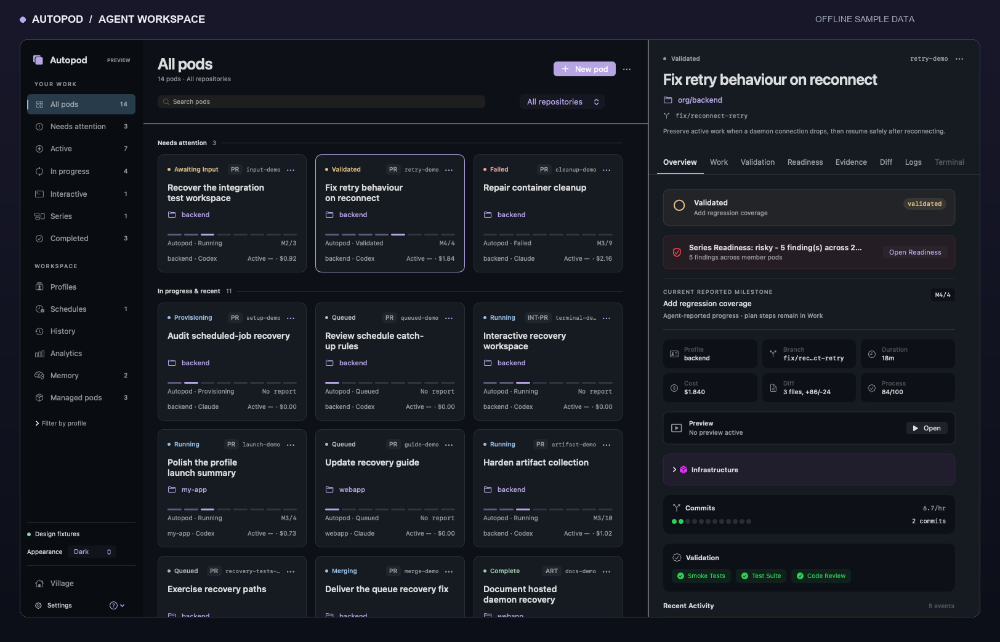
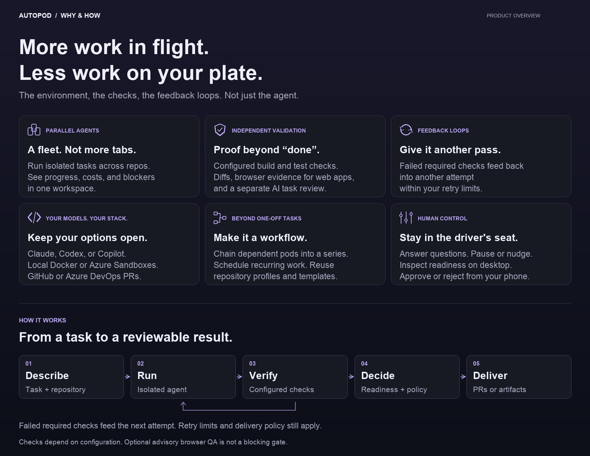
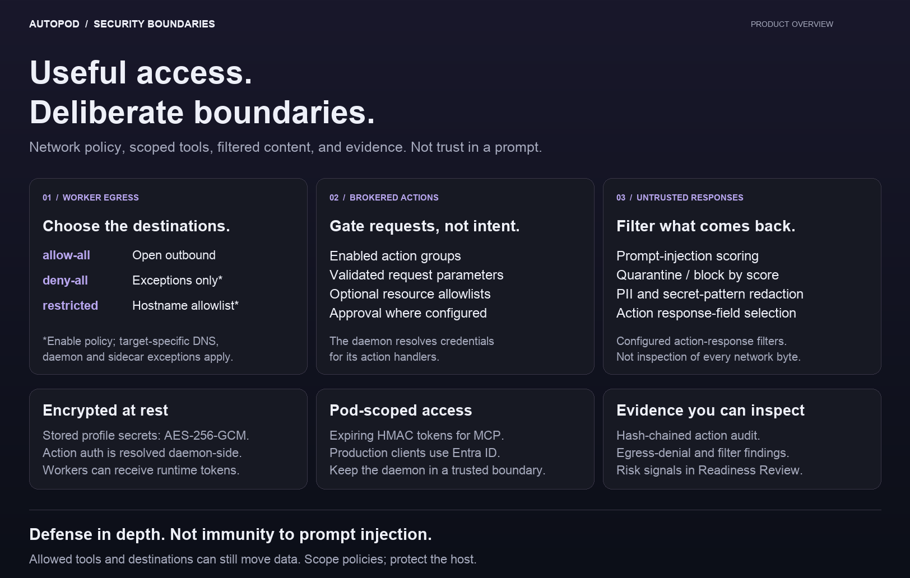
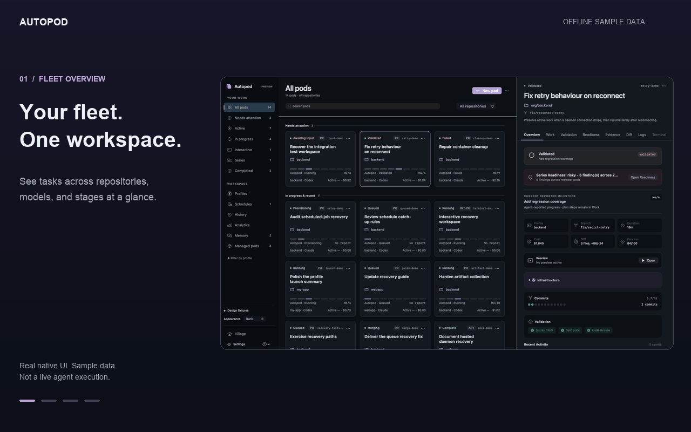
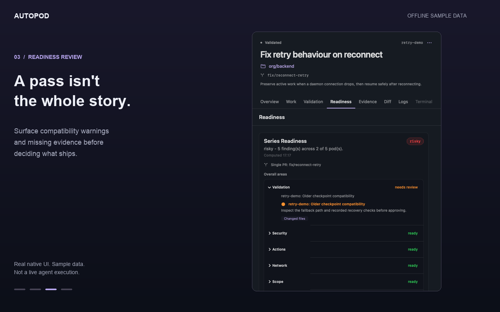

<p align="center">
  
</p>

<h1 align="center">Autopod</h1>

<p align="center">
  <strong>Delegate the work. Review the evidence.</strong><br>
  Run coding agents in isolated containers, validate their changes, and stay in control of what ships.
</p>

<p align="center">
  <a href="#why-autopod">Why Autopod</a> ·
  <a href="#how-it-works">How it works</a> ·
  <a href="#security-boundaries">Security</a> ·
  <a href="#see-it-in-action">See it in action</a> ·
  <a href="#getting-started">Get started</a> ·
  <a href="#documentation">Documentation</a> ·
  <a href="https://esbenwiberg.github.io/autopod">Explore the docs ↗</a>
</p>

[](assets/readme/desktop.png)

<p align="center">
  <sub>macOS desktop preview · real UI, offline sample data · click to enlarge</sub>
</p>

## Why Autopod

Starting an agent is easy. Turning its output into a change you can confidently
review is the real work.

Autopod connects the parts around the agent—isolated environments, parallel work,
independent checks, and feedback loops—so **you're not the glue holding every
task together.**

[](assets/readme/features.png)

## Security boundaries

A prompt is not a permission boundary. Autopod puts controls around the worker,
the tools it can call, and the external content those tools return. Repository
checkpoints add secret detection and optional ML-backed PII/injection scanning.

[](assets/readme/security.png)

**Current limit:** default remote-MCP proxy wiring does not enable its response
filters; the action-response filtering above is a separate path.
[Enforcement details, policy exceptions, and honest limits →](docs/security-overview.md)

## See it in action



<p align="center">
  <sub>The redesigned desktop, enabled in Appearance settings. Offline sample data—not a live agent run.<br>
  Prefer a still? <a href="assets/readme/desktop.png">Open the workspace screenshot</a>.</sub>
</p>

### Review the evidence, not just the status

[](assets/readme/readiness.png)

## Beyond a single run

- **Prepare interactively, then hand off.** Workspace pods give you a container
  for exploration or manual fixes before an automated agent takes over.
- **Keep lessons, not every chat.** Scoped, human-approved memory carries useful
  knowledge forward with source evidence and usage history.
- **Close the loop around the PR.** Configured issue watchers can turn labeled
  issues into work; bounded fix pods can respond to CI failures and review comments.
- **Bring the awkward parts of your stack.** Private npm/NuGet feeds, warmed
  images, injected MCP tools, and skills fit into repository-specific setups.
- **Set allowances, not just reminders.** Optional whole-task token budgets help
  bound reported usage; they are not exact provider spending caps.

[Repository integrations →](docs/reference/profiles.md) ·
[Workspaces and automation →](docs/reference/cli.md) ·
[Token-budget behavior →](docs/reference/operations.md#task-token-limits)

## How it works

One long-running daemon coordinates short-lived workers. The desktop, CLI, and
phone are clients of that same control plane—not separate orchestration systems.
Repository configuration supplies the environment; task contracts can add
executable proof requirements.

Workers change code and report evidence. The daemon owns configured independent
validation, source/delivery guards, and authorized publication. Manual approval
and configured auto-approval both follow readiness and external delivery policy.
A passing review is not approval, publication, or proof of a merge. Optional
advisory browser QA adds context, not a blocking validation gate.

[Architecture →](ARCHITECTURE.md) ·
[Validation and readiness →](docs/reference/validation.md)

## Getting started

Autopod is self-hosted. The daemon runs the work; the macOS app, CLI, and phone
PWA connect to it. You can run workers locally with Docker or configure Azure
Container Apps Sandboxes.

**For local development:** Node.js 22+, Git, Docker, and GitHub CLI for
GitHub-backed repositories. The desktop app additionally needs macOS 15+ and
Xcode. Hosted sign-in uses Azure Entra ID.

```bash
git clone https://github.com/esbenwiberg/autopod.git
cd autopod
npx pnpm install
npx pnpm build
```

**[Follow the setup guide →](docs/getting-started.md)** It covers daemon settings,
provider authentication, the `ap` CLI, and your first repository configuration.
Already have a daemon? [Connect to it instead](docs/getting-started.md#connect-to-an-existing-daemon).

Once configured, the basic CLI workflow is:

```bash
ap run my-app "Add a dark mode toggle to the settings page"
ap ls
ap status <pod-id>
ap diff <pod-id>
ap approve <pod-id>
# Want another iteration instead?
ap reject <pod-id> "The selected theme should survive a page refresh"
```

## One daemon. Three ways to stay in control.

- **macOS app** — browse the fleet, inspect diffs and evidence, manage repository
  configuration, and work in a live terminal. [Build the app →](docs/getting-started.md#use-the-macos-app)
- **CLI** — launch tasks, follow activity, and script your workflows.
  [Command reference →](docs/reference/cli.md)
- **Phone PWA** — answer escalations and approve, reject, kill, or nudge work
  through a Tailscale-served inbox. [Pair your phone →](docs/mobile.md)

## Documentation

| Start here | Go deeper |
| :-- | :-- |
| [Setup & first task](docs/getting-started.md) | [CLI & dependent pod workflows](docs/reference/cli.md) |
| [Repository profiles & providers](docs/reference/profiles.md) | [Validation, evidence & readiness](docs/reference/validation.md) |
| [Mobile access](docs/mobile.md) | [Authentication, deployment & operations](docs/reference/operations.md) |
| [Architecture](ARCHITECTURE.md) | [Azure Container Apps Sandboxes](docs/azure-container-apps-sandboxes.md) |
| [Contributing](CONTRIBUTING.md) | [Security boundaries & limitations](docs/security-overview.md) |

## Development

```bash
npx pnpm lint
npx pnpm build
npx pnpm test
```

The daemon and CLI are TypeScript; the macOS app is SwiftUI/AppKit. See
[the development reference](docs/reference/operations.md#development) for package
layout and checks, and [the desktop test guide](docs/desktop/test-isolation.md)
for native tests.

## License

MIT

---

<p align="center">
  <sub>Spec in. Evidence out. You decide what ships.</sub>
</p>
